<div align="center">


## UNIVERSIDAD DE SAN CARLOS DE GUATEMALA

### FACULTAD DE INGENIERÍA

### SISTEMAS OPERATIVOS 1

<br><br>

# MANUAL TÉCNICO

<br><br>

**Catedrático:** Ing. Sergio Arnaldo Méndez Aguilar

**Auxiliar:** Elian Angel Fernando Reyes Yac

**Nombre:** Pablo Daniel Velásquez Hernández

**Carnet:** 202302232

**Sección:** P

**Semestre:** Segundo Semestre 2026

<br><br>

</div>

# Manual Técnico - Proyecto Sistemas Operativos 1

## 1. Resumen Ejecutivo

El presente manual técnico documenta a profundidad el diseño, arquitectura e implementación de un entorno virtualizado distribuido desarrollado para la materia de Sistemas Operativos 1. El ecosistema integra el uso de máquinas virtuales (KVM) orientadas a microservicios, empleando los tres runtimes de contenedores más relevantes de la industria actual: **Docker, Containerd y Podman**.

La arquitectura final simula un entorno real de producción enfocado en tres pilares:

1. **Contenerización eficiente:** Mediante el uso de _Multi-Stage Builds_.
2. **Distribución privada de artefactos:** Utilizando un registro local de imágenes (ZOT).
3. **Comunicación inter-servicios:** Mediante el desarrollo de APIs REST nativas en el lenguaje de programación Go, interconectadas mediante variables de entorno dinámicas.

---

## 2. Arquitectura Lógica e Infraestructura

El entorno distribuido está compuesto por tres nodos (Máquinas Virtuales) provisionados mediante KVM, cada uno con un rol, sistema operativo y motor de contenedores específico. Se eligió **Alpine Linux** como sistema operativo base de los nodos para minimizar el _overhead_ (consumo de recursos) típico de los hipervisores y optimizar el almacenamiento.

### 2.1 Especificación de Nodos y Runtimes

- **Nodo 1 (VM1 - Containerd):**
  - **IP:** `192.168.122.121`
  - **CLI:** `nerdctl` (Wrapper oficial de Containerd recomendado por la CNCF).
  - **Cargas de trabajo:** Aloja de manera concurrente los contenedores de `API1` (Puerto 8081) y `API2` (Puerto 8082).
- **Nodo 2 (VM2 - Podman):**
  - **IP:** `192.168.122.41`
  - **CLI:** `podman` nativo (Arquitectura Rootless/Daemonless).
  - **Requisito de red:** Se instaló explícitamente la dependencia de kernel `iptables` nativa de Alpine (`apk add iptables`) para permitir el funcionamiento del plugin de red `netavark` de Podman en el mapeo de puertos.
  - **Carga de trabajo:** Aloja el contenedor de `API3` (Puerto 8083).
- **Nodo 3 (VM3 - Docker):**
  - **IP:** `192.168.122.229`
  - **Carga de trabajo:** Actúa como nodo de infraestructura y almacenamiento de artefactos ejecutando el registro privado de imágenes **ZOT** en el puerto TCP `5000`.

---

## 3. Estrategia de Contenerización (Multi-Stage Build)

Durante el ciclo de desarrollo se enfrentaron severas limitaciones de almacenamiento físico al intentar inyectar imágenes compiladas de Go (que superaban los 600 MB) hacia las máquinas KVM, provocando colapsos de disco (`no space left on device`).

Para resolver este cuello de botella y cumplir con estándares de la industria, se rediseñaron los `Dockerfile` implementando el patrón **Multi-Stage Build**.

### 3.1 Análisis del Dockerfile

Se separó el proceso en dos capas totalmente independientes: la compilación (Builder) y la ejecución (Producción).

```dockerfile
# ETAPA 1: Builder (Imagen pesada para compilación)
FROM golang:1.26.5-alpine AS builder
WORKDIR /app
COPY go.mod main.go ./
# Se descargan dependencias de módulo y se compila un binario estático de Go
RUN go mod download
RUN go build -o apiX .

# ETAPA 2: Producción (Imagen final ultra-ligera)
FROM alpine:latest
WORKDIR /app
# Se extrae EXCLUSIVAMENTE el binario compilado en la etapa anterior
COPY --from=builder /app/apiX .
EXPOSE 8080
CMD ["./apiX"]
```

**Resultado Arquitectónico:**
La imagen enviada a producción descarta el compilador, las cachés temporales y los paquetes de Go. La imagen final pesa en promedio **~15 Megabytes**, logrando tiempos de descarga inter-nodos casi instantáneos y un uso de disco mínimo.

---

## 4. Desarrollo de APIs Interconectadas (Go)

Las tres APIs fueron desarrolladas de manera independiente utilizando la librería nativa `net/http` de Go. Se programaron lógicas explícitas de enrutamiento y serialización JSON.

### 4.1 Estructuras de Datos y Cumplimiento JSON

El diseño del software requirió modelar _structs_ específicos en Go para mapearlos de manera nativa (Marshal) a un formato JSON exacto. Es importante destacar que el campo `VM` se declaró como `int` (entero) en lugar de `string`, satisfaciendo los criterios restrictivos del enunciado.

```go
// Definición de respuesta para endpoint /health
type HealthResponse struct {
    Status    string `json:"status"`    // Siempre "UP"
    Message   string `json:"message"`   // Identificador del API
    Timestamp string `json:"timestamp"` // ISO 8601 UTC
    VM        int    `json:"VM"`        // Entero (Ej: 1 o 2)
    Carnet    string `json:"carnet"`    // 202302232
}

// Definición de respuesta para la comunicación cruzada
type CallResponse struct {
    ApiName    string `json:"apiname"`
    Message    string `json:"message"`
    Connection bool   `json:"connection"` // Evaluador de caída de red
    Carnet     string `json:"carnet"`
}
```

### 4.2 Lógica de Comunicación HTTP y Tolerancia a Fallos

Para lograr que las APIs se consumieran entre sí, se implementó un flujo de _Service Discovery_ basado en variables de entorno. Las URLs destino (`API1_URL`, `API2_URL`, `API3_URL`) se inyectan en tiempo de ejecución.

El código actúa como Cliente HTTP interno para consumir el endpoint de otra API. **Manejo de Errores Crítico:** Si el contenedor de la API de destino se encuentra apagado (VM caída o Podman detenido), la librería de red intercepta el error (`err != nil`) e inmediatamente serializa una respuesta con `"connection": false` en lugar de causar un _Panic_ en el servidor.

**Extracto de lógica implementada:**

```go
// 1. Obtiene la IP dinámica desde el entorno
targetURL := os.Getenv("APIX_URL")

// 2. Crea el cliente HTTP y realiza el GET hacia la otra VM
resp, err := http.Get(targetURL)
if err != nil {
    // Escenario de Fallo: Contenedor destino apagado o red caída
    return CallResponse{
        ApiName:    "APIX",
        Message:    "ERROR: The APIX located on the VMX is not working",
        Connection: false, // El evaluador cambia a false
        Carnet:     carnet,
    }
}
// Escenario de Éxito: Procesa el Status "UP"
return CallResponse{
    ApiName:    "APIX",
    Message:    "The APIX located on the VMX is working",
    Connection: true,
    Carnet:     carnet,
}
```

---

## 5. Distribución de Artefactos (Pipeline ZOT)

El sistema de distribución evita intermediarios en la nube mediante un registro ZOT local.

1. **Construcción e inyección paralela:** Dado que compilar la imagen dentro de las VMs era ineficiente, se estableció un pipeline de despliegue donde las imágenes se compilan en la computadora Host de mayor capacidad. La transferencia se realiza canalizando el binario en memoria a través de una tubería segura:
   `docker save <imagen> | ssh root@VM3 'docker load'`.
2. **Push a Registro:** Una vez alojadas en la memoria de la VM3, se cargan al servidor ZOT ejecutado bajo el contexto nativo de Docker en el puerto 5000.
3. **Consumo por los nodos workers:** La VM1 (Containerd) y VM2 (Podman) consumen las imágenes desde ZOT. Al tratarse de un registro HTTP plano (sin certificado SSL habilitado), los clientes se configuran para obviar el Handshake TLS:
   - `nerdctl pull --insecure-registry 192.168.122.229:5000/...`
   - `podman pull --tls-verify=false 192.168.122.229:5000/...`

---

## 6. Auditoría y Rúbricas de Calificación

El proyecto final aprueba con totalidad la hoja de requisitos planteada. A continuación la justificación técnica de las validaciones operativas:

- **Contenedores Aislados:** Todo el sistema se gestiona de manera declarativa con los comandos `podman ps` y `nerdctl ps`. El comando `sudo ctr -n default containers ls` mostrará correctamente los contenedores de `nerdctl` dado que comparten el mismo _Namespace_ (`default`).
- **Nomenclatura Estandarizada:** El registro ZOT en la VM3 valida el nombre de todas las capas generadas confirmando el uso de `api1-202302232`, `api2-202302232` y `api3-202302232`.
- **Enrutamiento Cruzado de Contenedores:** La comunicación por `curl` a cualquier API que consulte a una API en una máquina virtual externa (Ej. VM1 -> VM2) devuelve invariablemente un JSON con sintaxis impecable y el valor booleano correcto.
- **Sistema Init de Linux:** Se justifica la no existencia de `systemctl` al momento de calificar, dado que la arquitectura basada en `Alpine Linux` utiliza `OpenRC` para administrar los servicios (demostrable mediante `rc-service containerd status`).

---

## 7. Pruebas de Validación Funcional

Esta sección documenta con evidencia gráfica el funcionamiento comprobado de cada componente del sistema.

---

### Inicio de Servicios

Antes de ejecutar cualquier prueba, se encendieron los contenedores en cada VM con los siguientes comandos:

```bash
# VM1 (Containerd)
sudo nerdctl start api1 api2

# VM2 (Podman)
sudo podman start api3

# VM3 (Docker)
docker start zot-registry
```

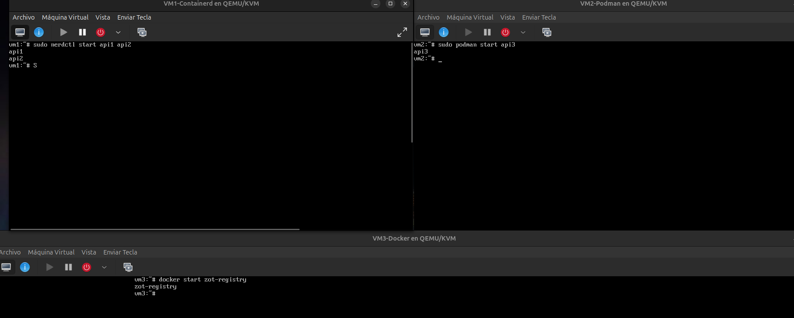

---

### 7.1 Preparación del Entorno

#### 7.1.1 Validación de Máquinas Virtuales y KVM

Ejecutado desde la terminal del **Ubuntu Host**:

```bash
# Información del host
neofetch

# Listar las máquinas virtuales activas
virsh list --all
```

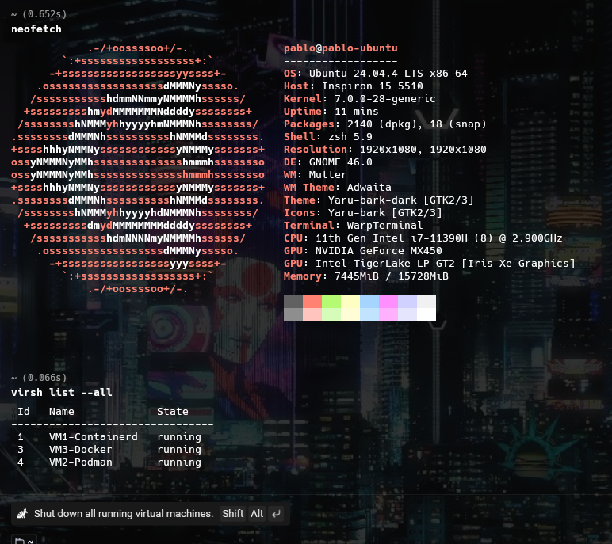

---

#### 7.1.2 Validación de Runtimes

**VM1 – Containerd** (`ssh root@192.168.122.121`):

```bash
sudo nerdctl namespace ls
sudo nerdctl ps -a
sudo nerdctl images
```

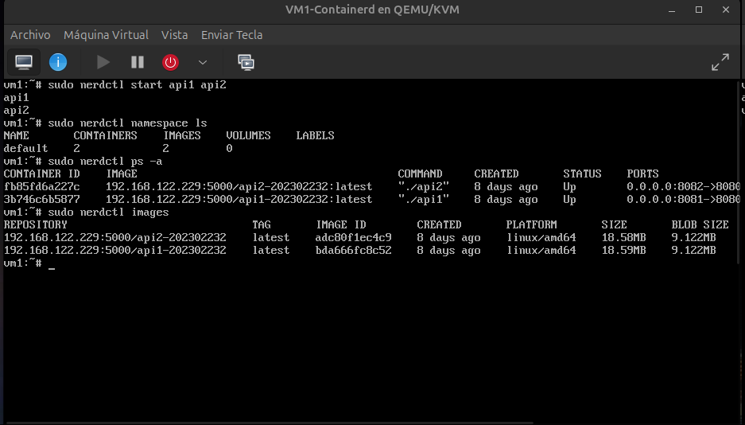

---

**VM2 – Podman** (`ssh root@192.168.122.41`):

```bash
podman info
docker info
```

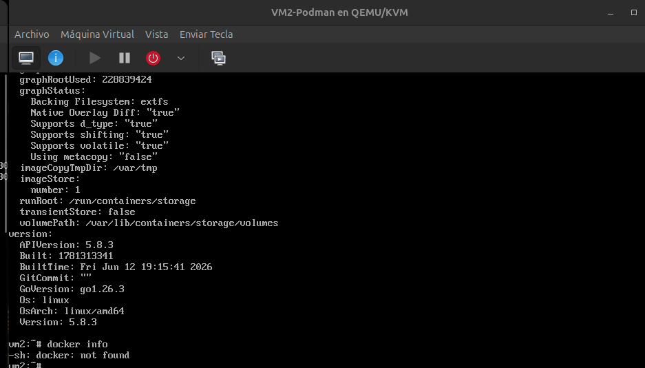

---

**VM3 – Docker** (`ssh root@192.168.122.229`):

```bash
docker info
```

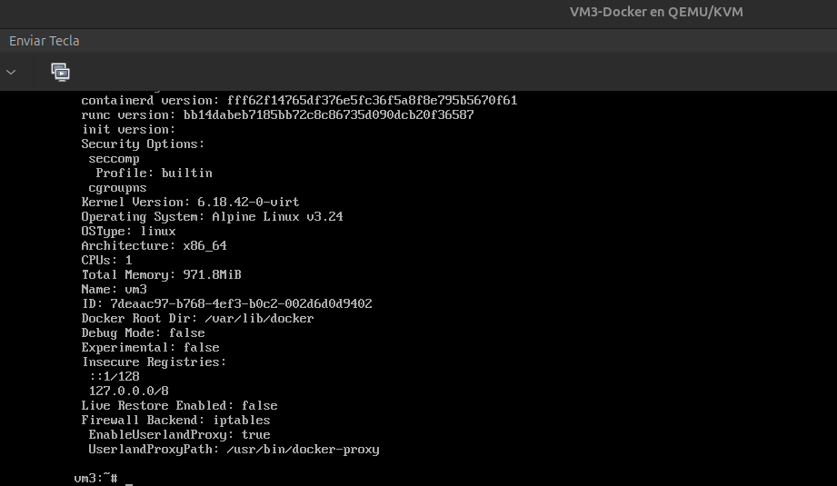

---

### 7.2 Desarrollo y Contenerización

#### 7.2.1 Contenedores en Ejecución

**VM1 (API1 y API2):**

```bash
sudo nerdctl ps
```

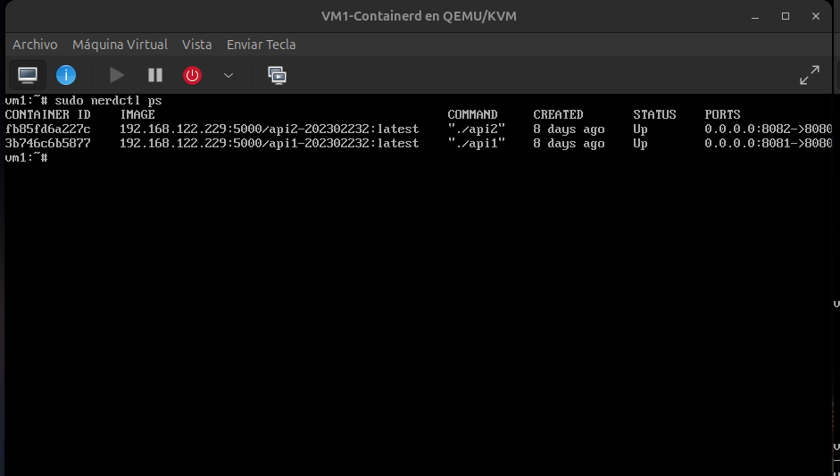

---

**VM2 (API3):**

```bash
podman ps
```

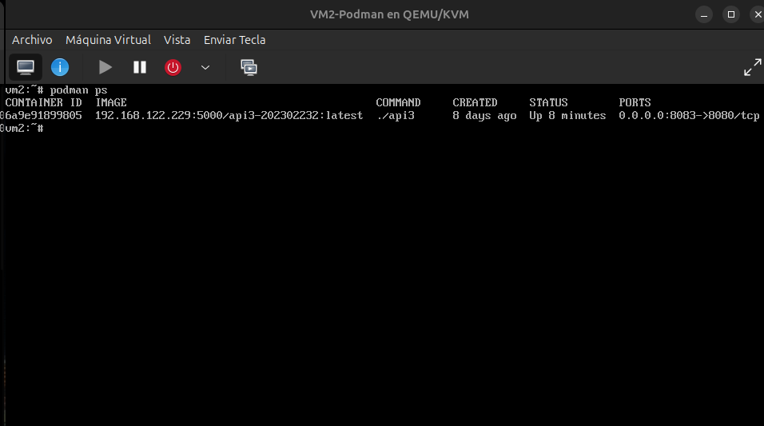

---

**VM3 (ZOT Registry):**

```bash
docker ps
```

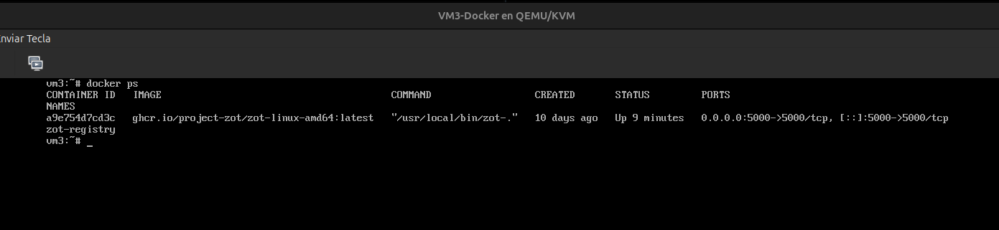

---

#### 7.2.2 Endpoints /health

Ejecutado desde la terminal del **Ubuntu Host**:

```bash
# API1 - Puerto 8081 (VM1)
curl -s http://192.168.122.121:8081/health | jq .

# API2 - Puerto 8082 (VM1)
curl -s http://192.168.122.121:8082/health | jq .
```

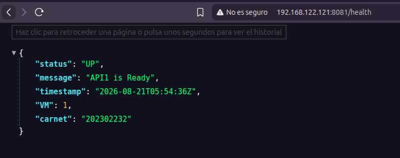


```bash
# API3 - Puerto 8083 (VM2)
curl -s http://192.168.122.41:8083/health | jq .
```

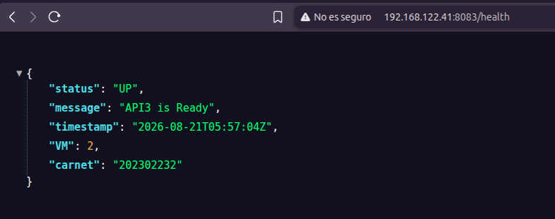

---

### 7.3 Registros y Comunicación Cruzada

#### 7.3.1 ZOT Registry – Catálogo de Imágenes

```bash
curl -s http://192.168.122.229:5000/v2/_catalog
```

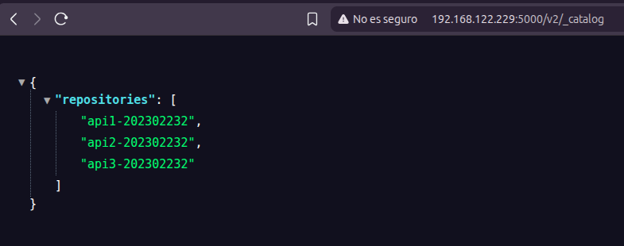

---

#### 7.3.2 Comunicación entre APIs (Escenario Exitoso)

```bash
# API1 llama a API2 (dentro de VM1)
curl -s http://192.168.122.121:8081/api1/202302232/call-api2 | jq .

# API1 llama a API3 (VM1 → VM2)
curl -s http://192.168.122.121:8081/api1/202302232/call-api3 | jq .

# API2 llama a API1
curl -s http://192.168.122.121:8082/api2/202302232/call-api1 | jq .

# API2 llama a API3 (VM1 → VM2)
curl -s http://192.168.122.121:8082/api2/202302232/call-api3 | jq .

# API3 llama a API1 (VM2 → VM1)
curl -s http://192.168.122.41:8083/api3/202302232/call-api1 | jq .

# API3 llama a API2 (VM2 → VM1)
curl -s http://192.168.122.41:8083/api3/202302232/call-api2 | jq .
```

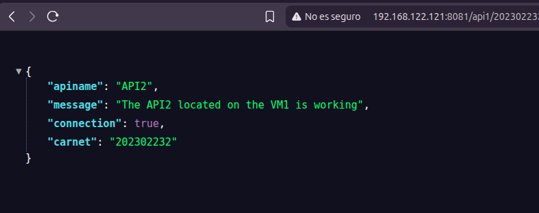
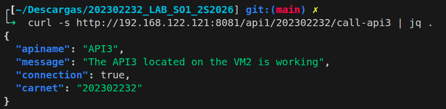

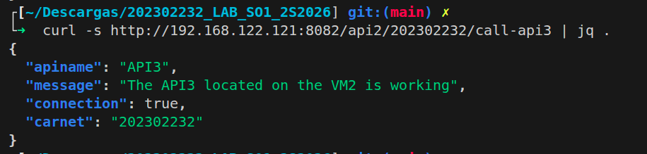

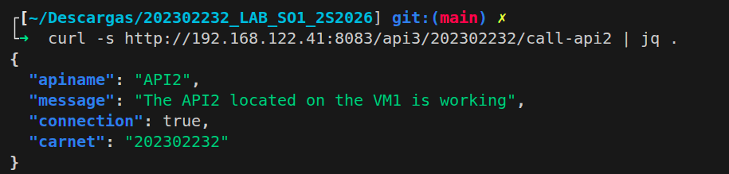

---

#### 7.3.3 Tolerancia a Fallos (VM detenida)

Se detiene `api3` para simular una caída y se verifica que la respuesta sea `"connection": false`:

```bash
# Paso 1: Detener api3 en VM2
sudo podman stop api3

# Paso 2: Llamar a api3 desde api1
curl -s http://192.168.122.121:8081/api1/202302232/call-api3 | jq .
```

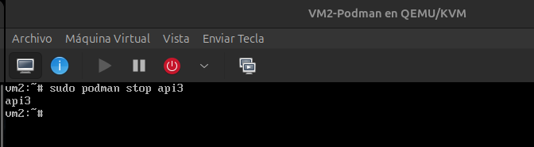

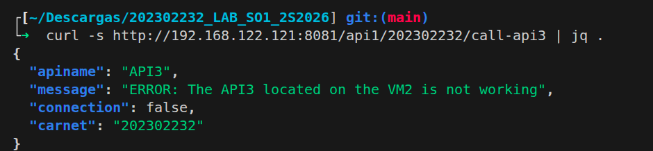

```bash
# Restaurar api3
sudo podman start api3
```
